# iztop

[](LICENSE)
[](https://github.com/GladTechInfo/iztop/releases/latest)
[](https://github.com/GladTechInfo/iztop/actions/workflows/ci.yml)
[](#11-development)


**A terminal monitor for ZFS pools on Linux: `zpool iostat -v`, drawn as a live dashboard.** One box
per pool and one row per vdev and disk, with operations, bandwidth and latency, how busy each
disk is, pool health and error counters, capacity, fragmentation, and scrub or resilver progress.
It is the storage companion to [igtop](https://github.com/GladTechInfo/igtop) (GPUs) and
[istop](https://github.com/GladTechInfo/istop) (the whole system), and shares their look.

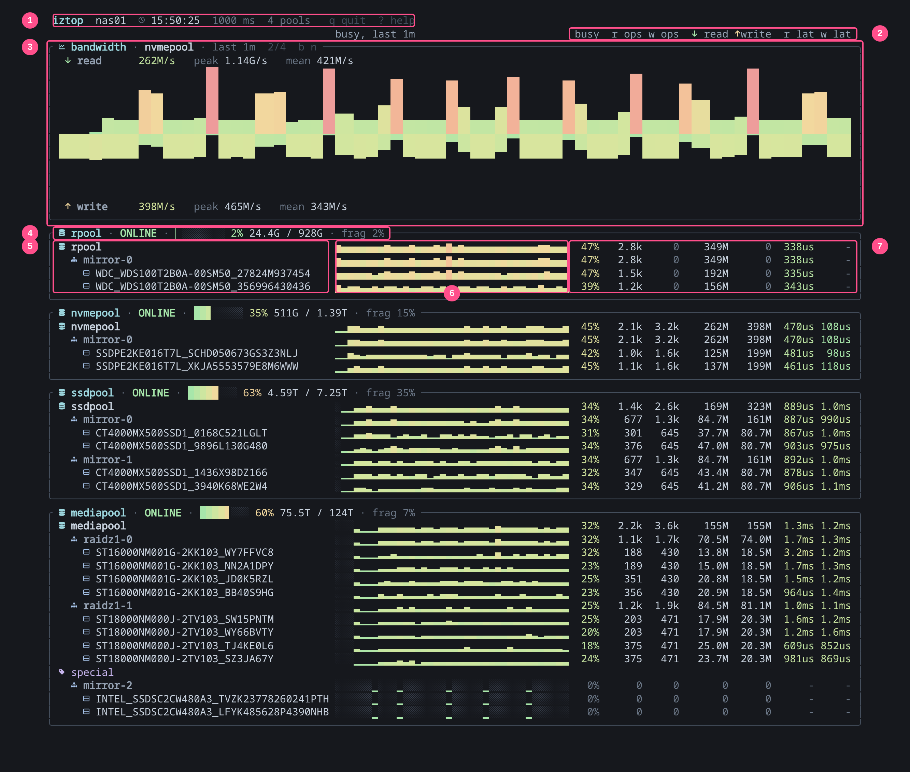

## Contents

1. [Introduction](#1-introduction)
2. [Features](#2-features)
3. [Screenshots](#3-screenshots)
4. [Quick Start](#4-quick-start)
5. [Installation](#5-installation)
6. [Usage Guide](#6-usage-guide)
7. [Keyboard Shortcuts](#7-keyboard-shortcuts)
8. [Understanding the Interface](#8-understanding-the-interface)
9. [Advanced Usage](#9-advanced-usage)
10. [Technical Details](#10-technical-details)
11. [Development](#11-development)
12. [Licence](#12-licence)

---

## 1. Introduction

### What iztop is

[ZFS](https://openzfs.org/) is a filesystem and volume manager that groups disks into **pools**.
Inside a pool, disks are arranged in **vdevs** (virtual devices) — mirrors, raidz groups or single
disks. ZFS's own `zpool iostat -v` command prints how much each vdev and disk is reading and writing,
but as a scrolling wall of numbers.

iztop runs that command for you and draws its figures as a live, readable screen: one box per pool,
one row per vdev and disk, with a graph of how busy each disk has been, coloured from green to red.
It adds what `iostat` does not show — health, error counters, capacity, fragmentation and scrub
progress — and a bandwidth graph. Graphs span the last minute, ten minutes or hour.

### The problem it solves

| Question | How iztop answers it |
|---|---|
| Which disk is holding the pool back? | A **busy** history graph per disk, from the kernel's own block-layer accounting. A mirror or raidz row shows its busiest disk. |
| Is the pool healthy? | Health in the box title; any vdev or disk that is not ONLINE, or has errors, is named in red on its row. |
| How long will the scrub take? | Scrub or resilver progress, rate and time left in the box title. |
| How fast is it reading and writing, and how long does each I/O wait? | Operations, bandwidth and latency per row, exactly as `zpool iostat` measures them. |
| Will it fit beside my other panes? | Designed for a half-width terminal pane: columns drop away as the window narrows. |

### Who it is for

- **Home-lab and NAS users** running ZFS on Proxmox VE, Debian, Ubuntu or another distribution.
- **Administrators** who want pool health and I/O at a glance during a scrub, resilver, backup or
  migration.
- **Advanced users and developers** who want a scriptable `--once` mode and documented data sources.

---

## 2. Features

| Feature | Description |
|---|---|
| **Per-pool boxes** | One box per pool, one row per vdev and disk, laid out as `zpool iostat -v` lays them out. |
| **Busy history** | A one-row graph per disk of the share of time it had I/O in flight, from `/proc/diskstats`, over the last 1, 10 or 60 minutes. A mirror, raidz or pool row shows its busiest disk. |
| **iostat figures** | Read and write operations, bandwidth and latency (total wait) per row, over the refresh interval. |
| **Health and errors** | Pool health in the title; a vdev or disk that is not ONLINE, or has READ/WRITE/CKSUM errors, is shown in red on its row. |
| **Capacity and fragmentation** | A capacity gauge, allocated and total size, and fragmentation in each title. |
| **Scrub and resilver** | Progress, rate and time left while one runs; errors found afterwards. |
| **Bandwidth graph** | Read and write for one pool over the same 1, 10 or 60 minutes; follows the busiest pool unless you choose one. |
| **Pools menu** | Order pools, show or hide them, and save the choice. |
| **Narrow-friendly** | Latency, then operations, are dropped as the terminal narrows; long disk names keep their serial number. |
| **Scripting** | `--once` prints one interval as a plain-text table. |
| **Safe and small** | One static binary; written in Rust with `#![forbid(unsafe_code)]`; it only reads. |

---

## 3. Screenshots

All screenshots are genuine captures of iztop. To keep them free of private data, iztop ran with
the host name `demo` against three small **demonstration pools** built on loop devices — `tank` (a
three-disk raidz1), `fast` (a two-way mirror) and `backup` (a single disk) — with demonstration
reads, writes and a scrub running. Disk names therefore appear as `loop0`…`loop5`; on real hardware
they are the disks' model and serial numbers. Nothing has been edited.

**Three pools with each area numbered** — explained in
[Understanding the Interface](#8-understanding-the-interface).


**A degraded pool** — one disk of `tank` was taken offline: the title and rows turn red, and the
offline disk's graph is empty.

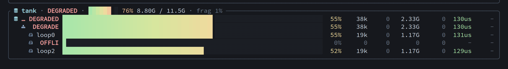

**A half-width pane (90 columns)** — the same pools, with the bandwidth graph above them.

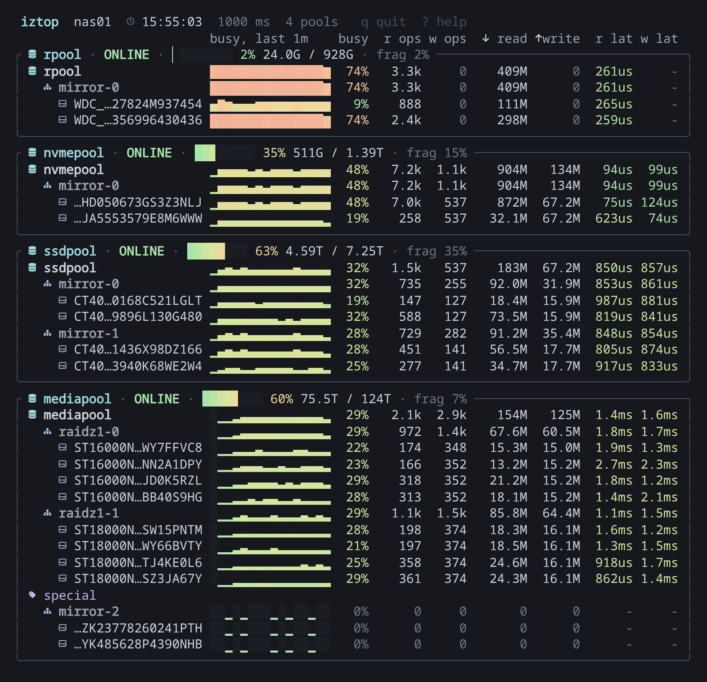

---

## 4. Quick Start

On **Debian, Ubuntu or Proxmox VE** with ZFS already set up, the quickest way is the ready-made
package from the latest release:

```sh
ver=$(curl -s https://api.github.com/repos/GladTechInfo/iztop/releases/latest | sed -n 's/.*"tag_name": "v\(.*\)".*/\1/p')
curl -LO "https://github.com/GladTechInfo/iztop/releases/download/v$ver/iztop_${ver}-1_amd64.deb"
sudo apt install "./iztop_${ver}-1_amd64.deb"
sudo iztop          # start the monitor; q quits, ? lists every key
```

The first line asks GitHub for the latest version number; the second downloads that version's
package; the third installs it.

For every other distribution, see [Installation](#5-installation).

---

## 5. Installation

### 5.1 Requirements

| Requirement | Details |
|---|---|
| **Operating system** | Linux on x86-64 (64-bit Intel or AMD processors). |
| **OpenZFS** | The `zpool` command, from OpenZFS. **2.3 or later** for health, error counters and scrub detail (`zpool status -j`); on older versions iztop still runs, with health from `zpool list` alone. Check with `zpool version`. |
| **Privileges** | Root, or a user allowed to run `zpool iostat` and `zpool status`. |
| **Font** | A [Nerd Font](https://www.nerdfonts.com/) in your terminal for the icons; otherwise use `--no-icons` or press `i`. |

iztop does not install or configure ZFS. If `zpool list` does not work on your machine, set up ZFS
first:

| Distribution | Where OpenZFS comes from |
|---|---|
| Proxmox VE | Included. |
| Debian | `zfsutils-linux` and `zfs-dkms`, from the `contrib` section (OpenZFS 2.3 is in `bookworm-backports` for Debian 12). |
| Ubuntu | `sudo apt install zfsutils-linux` (the kernel module ships with Ubuntu's kernels). |
| Fedora, RHEL, Rocky, Alma | The OpenZFS project's own repository; see the [OpenZFS documentation](https://openzfs.github.io/openzfs-docs/Getting%20Started/index.html). |
| openSUSE | The `filesystems` repository; see the [OpenZFS documentation](https://openzfs.github.io/openzfs-docs/Getting%20Started/index.html). |
| Arch Linux | `zfs-utils` with a matching kernel module, from the AUR or the archzfs repository. |
| CachyOS | `zfs-utils` and a ZFS-enabled kernel from CachyOS's repositories. |

The distribution notes for Fedora, openSUSE, Arch Linux and CachyOS summarise their own
documentation and were not tested for this README; follow your distribution's instructions where
they differ.

### 5.2 Choosing an installation method

| Method | Best for | Updates |
|---|---|---|
| [Release package](#53-release-packages-deb-and-rpm) (`.deb`, `.rpm`) | Debian, Ubuntu, Proxmox VE, Fedora, RHEL and rebuilds, openSUSE | Install the newer package |
| [Arch Linux / CachyOS package](#54-arch-linux-and-cachyos) | Arch Linux, CachyOS and other Arch-based systems | Rebuild with `makepkg` |
| [Static binary](#55-other-distributions-static-binary) | Any other x86-64 distribution | Replace the file |
| [From source on GitHub](#56-building-from-source-github) | Developers; unreleased changes | `git pull` and rebuild |

A **package-manager installation** puts iztop under `/usr/bin` and lets your package manager track,
update and remove it. A **manual installation** (static binary or a source build) puts it wherever
you copy it — usually `/usr/local/bin` — and you update and remove it yourself.

### 5.3 Release packages (.deb and .rpm)

Every [GitHub release](https://github.com/GladTechInfo/iztop/releases/latest) carries four files:

| File | For | Installs to |
|---|---|---|
| `iztop_<version>-1_amd64.deb` | Debian, Ubuntu, Proxmox VE | `/usr/bin/iztop` |
| `iztop-<version>-1.x86_64.rpm` | Fedora, RHEL, Rocky Linux, AlmaLinux, openSUSE | `/usr/bin/iztop` |
| `iztop-<version>-x86_64-linux` | Any x86-64 Linux | wherever you copy it |
| `SHA256SUMS` | Checksums of the three files above | |

All three contain the same statically linked binary and need no libraries — only the `zpool`
command. The Debian package *recommends* `zfsutils-linux`. Before a release's files are uploaded,
the release workflow installs and removes each package in containers of Debian 12 and 13, Ubuntu
22.04 and 24.04, Fedora, Rocky Linux 9, openSUSE Tumbleweed and Alpine, and checks that iztop
reports the missing `zpool` command correctly there.

These are packages attached to GitHub releases, not packages in your distribution's own
repositories: `apt install iztop` without a file name will not find them.

**Step 1 — download the package and its checksums:**

```sh
ver=$(curl -s https://api.github.com/repos/GladTechInfo/iztop/releases/latest | sed -n 's/.*"tag_name": "v\(.*\)".*/\1/p')
base=https://github.com/GladTechInfo/iztop/releases/download/v$ver
curl -LO "$base/SHA256SUMS"
curl -LO "$base/iztop_${ver}-1_amd64.deb"        # Debian, Ubuntu, Proxmox VE
curl -LO "$base/iztop-${ver}-1.x86_64.rpm"       # Fedora, RHEL, openSUSE
```

To install a particular version instead of the latest, set it by hand, for example `ver=0.1.0`.

**Step 2 — check the download.** This must print `OK` for the file you downloaded:

```sh
sha256sum --check --ignore-missing SHA256SUMS
```

The packages are not signed; this checksum is the check that the file is the one published here.

**Step 3 — install it** with the command for your distribution:

| Distribution | Install command | Notes |
|---|---|---|
| Debian 12, 13 | `sudo apt install ./iztop_*_amd64.deb` | The `./` tells `apt` to install a local file. |
| Ubuntu 22.04, 24.04 and later | `sudo apt install ./iztop_*_amd64.deb` | As Debian. |
| Proxmox VE | `sudo apt install ./iztop_*_amd64.deb` | As root, omit `sudo`. |
| Fedora | `sudo dnf install ./iztop-*.x86_64.rpm` | |
| RHEL, Rocky Linux, AlmaLinux | `sudo dnf install ./iztop-*.x86_64.rpm` | |
| openSUSE Tumbleweed, Leap | `sudo zypper install --allow-unsigned-rpm ./iztop-*.x86_64.rpm` | `zypper` refuses unsigned local packages without the flag. |

**Step 4 — confirm it works:** `iztop --version`, then `sudo iztop --once`.

### 5.4 Arch Linux and CachyOS

iztop is **not yet in the AUR**. This repository carries a ready `PKGBUILD` in `packaging/aur`;
build and install it with `makepkg`, which downloads the release's source, compiles it, runs the
tests and installs the result under `/usr/bin` through `pacman`:

```sh
sudo pacman -S --needed git base-devel rust      # build tools, if not already installed
git clone https://github.com/GladTechInfo/iztop
cd iztop/packaging/aur
makepkg -si                                       # build, then install with pacman
```

CachyOS and other Arch-based distributions use the same steps. If you use `rustup` rather than the
`rust` package, leave `rust` out of the first command. To remove it later: `sudo pacman -R iztop`.

### 5.5 Other distributions (static binary)

The static binary runs on any x86-64 Linux distribution, whatever its C library:

```sh
ver=$(curl -s https://api.github.com/repos/GladTechInfo/iztop/releases/latest | sed -n 's/.*"tag_name": "v\(.*\)".*/\1/p')
base=https://github.com/GladTechInfo/iztop/releases/download/v$ver
curl -LO "$base/SHA256SUMS"
curl -LO "$base/iztop-${ver}-x86_64-linux"
sha256sum --check --ignore-missing SHA256SUMS                     # must print OK
sudo install -m 0755 "iztop-${ver}-x86_64-linux" /usr/local/bin/iztop
```

`install -m 0755` copies the file and makes it executable for every user. This is also the simplest
way to put iztop on a hypervisor or NAS where you would rather not install a compiler.

### 5.6 Building from source (GitHub)

**Step 1 — install Git, a C linker and `curl`:**

| Distribution | Command |
|---|---|
| Debian, Ubuntu, Proxmox VE | `sudo apt install git curl build-essential` |
| Fedora, RHEL, Rocky, Alma | `sudo dnf install git curl gcc binutils` |
| openSUSE | `sudo zypper install git curl gcc binutils` |
| Arch Linux, CachyOS | `sudo pacman -S --needed git curl base-devel` |
| Alpine | `sudo apk add git curl build-base` |

**Step 2 — install Rust 1.88 or later** with [rustup](https://rustup.rs/), the official installer
(distribution packages are often older — Debian 12 ships 1.63):

```sh
curl --proto '=https' --tlsv1.2 -sSf https://sh.rustup.rs | sh
. "$HOME/.cargo/env"          # make cargo available in this terminal
rustc --version               # should print 1.88.0 or later
```

On Arch Linux and CachyOS, `sudo pacman -S rustup && rustup default stable` does the same.

**Step 3 — download the source code and enter it:**

```sh
git clone https://github.com/GladTechInfo/iztop
cd iztop
```

**Step 4 — build a release binary:**

```sh
cargo build --release
```

Cargo downloads the libraries iztop uses, compiles everything with optimisations and writes the
program to `target/release/iztop`.

**Step 5 — run it:** `sudo ./target/release/iztop`

**Step 6 — install it system-wide (optional):**

```sh
sudo install -m 0755 target/release/iztop /usr/local/bin/iztop
```

**Step 7 — update to the latest source later:**

```sh
cd iztop
git pull
cargo build --release
sudo install -m 0755 target/release/iztop /usr/local/bin/iztop
```

To build a particular release, check out its tag first, for example `git checkout v0.1.0`. For a
static binary that runs on other machines, see [Static builds](#static-builds).

### 5.7 Updating

| Installed with | How to update |
|---|---|
| `.deb` package | Download the newer `.deb` and install it the same way; `apt` replaces the old version. |
| `.rpm` package | Download the newer `.rpm` and install it the same way. |
| `makepkg` (Arch, CachyOS) | `cd iztop && git pull && cd packaging/aur && makepkg -si` |
| Static binary | Download the newer binary and repeat the `install` command. |
| Source build | See step 7 above. |

### 5.8 Uninstalling

| Installed with | How to remove |
|---|---|
| `.deb` package | `sudo apt remove iztop` |
| `.rpm` package (Fedora, RHEL) | `sudo dnf remove iztop` |
| `.rpm` package (openSUSE) | `sudo zypper remove iztop` |
| `makepkg` (Arch, CachyOS) | `sudo pacman -R iztop` |
| Static binary or source build | `sudo rm /usr/local/bin/iztop`, and delete the cloned directory if you have one. |

The only file iztop ever writes is its pools-menu configuration, and only when you press `W` in
that menu. To remove it too: `rm -r ~/.config/iztop` (as the user who saved it — `/root/.config` if
you ran iztop with `sudo`).

---

## 6. Usage Guide

### Starting iztop

```sh
sudo iztop
```

iztop shows every imported pool. The first screen appears after one interval (one second by
default), because every figure is a rate over that interval. Press `?` for help and `q` to quit.

### Everyday examples

| Command | What it does |
|---|---|
| `sudo iztop` | Every pool, refreshed once a second. |
| `sudo iztop tank` | Only the pool `tank`. Several names may be given. |
| `sudo iztop -i 5000` | Refreshes every 5 seconds, for a calmer view of a long job. |
| `sudo iztop -l` | Hides the disks inside mirrors and raidz vdevs: one row per vdev. |
| `sudo iztop -g on` | Always draws the bandwidth graph, even if pools must scroll. |
| `sudo iztop -g off` | Never draws the graph. |
| `sudo iztop --full-names` | Full device names, as `zpool iostat -P` prints them. |
| `sudo iztop --once` | Prints one interval as plain text and exits. |

### Watching a scrub or resilver

1. Start a scrub: `sudo zpool scrub tank`.
2. Run `sudo iztop tank`.
3. The pool's title shows `scrub 12.2% 276M/s 0m 28s left`: progress, current rate and estimated
   time remaining. The busy graphs show whether every disk is working evenly; one disk much busier
   than its partners is the one limiting the scrub.
4. When the scrub ends, the progress disappears from the title; if it found errors, the title says
   `scrub N errors` in red.

Health and scrub progress are read every 5 seconds, so a very short scrub may finish before it is
shown.

### Troubleshooting

| Symptom | Cause and remedy |
|---|---|
| `cannot run zpool: …` | The `zpool` command is not installed or not on the path. Install OpenZFS (see [Requirements](#51-requirements)). |
| `waiting for zpool iostat…` stays on screen | `zpool iostat` has produced no output yet. On a very slow or hung pool this can take a while; `zpool iostat 1` in another terminal shows the same delay. |
| `no pools` | No pool is imported. `zpool list` should show the same. |
| `every pool is hidden: d to choose` | All pools are hidden in the configuration. Press `d`, then `r` to show them all. |
| No health, error or scrub figures | OpenZFS is older than 2.3, which lacks `zpool status -j`. Health still comes from `zpool list`. |
| A disk's graph is an empty dotted track for its whole width | The vdev is a file, not a block device, so there is no busy figure for it. |
| The left of every graph is blank | iztop has not been running for the whole window yet; history starts when iztop does. |
| Columns are missing | The terminal is too narrow: latency is dropped first, then operations. Widen the window. |
| Squares or question marks instead of icons | The terminal font lacks Nerd Font glyphs. Install a [Nerd Font](https://www.nerdfonts.com/) or use `--no-icons`. |
| `Illegal instruction` from a binary you built | Your Rust standard library contains AVX-512; see [Static builds](#static-builds). |

---

## 7. Keyboard Shortcuts

Press `?`, `h` or `F1` in iztop for help. Help closes on any key (`q` still quits).

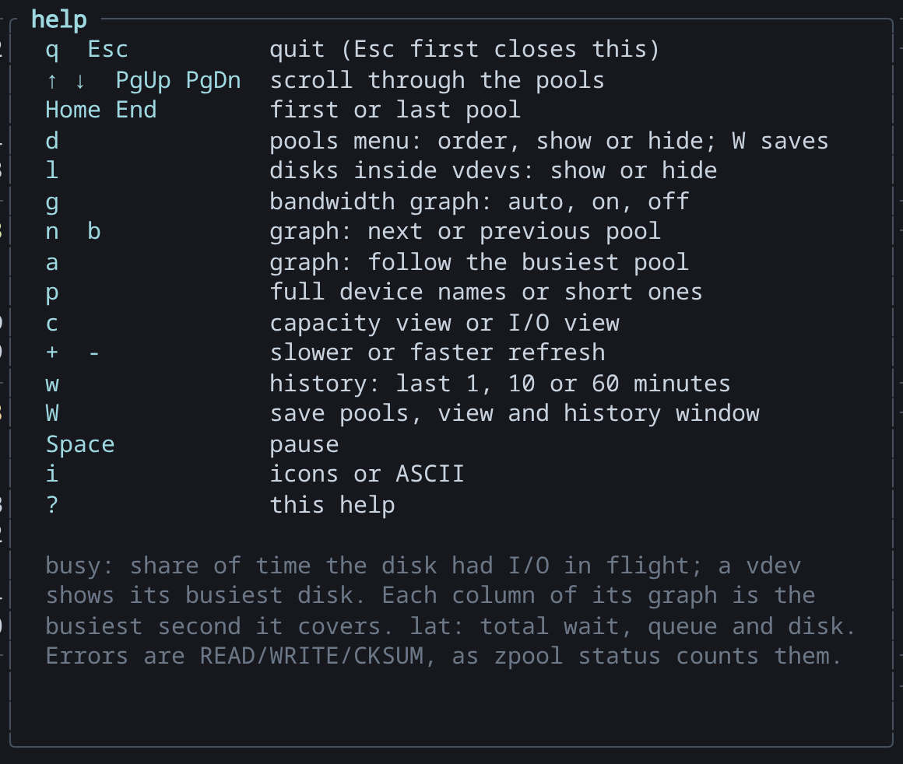

### General

| Key | Action | Explanation |
|---|---|---|
| `q`, `Esc`, `Ctrl+C` | Quit | Restores the terminal and exits. |
| `?`, `h`, `F1` | Help | Lists the keys; any key closes it. |
| `Space` | Pause or resume | Freezes the display. Rates start afresh on resume, so the first reading never averages the paused time. |
| `+` (or `=`) | Refresh **slower** | Steps the interval up: 250 → 500 → 1000 → 2000 → 5000 → 10000 ms. The header shows `refresh N ms`. |
| `-` | Refresh **faster** | Steps the interval down the same ladder. |
| `Ctrl+Z` | Suspend | Returns you to the shell; `fg` resumes iztop. |

Note that `+` and `-` work the opposite way round from igtop and istop, where `+` samples faster.

### Pools and rows

| Key | Action | Explanation |
|---|---|---|
| `↓`, `j`, `PgDn` | Scroll down | Moves the view down by one pool, when the pools do not all fit. |
| `↑`, `k`, `PgUp` | Scroll up | Moves the view up by one pool. |
| `Home`, `End` | First or last pool | Jumps to the first or last pool. |
| `l` | Disks on or off | Hides or shows the disks inside mirrors and raidz vdevs. The header confirms `vdevs only` or `disks shown`. |
| `p` | Full or short names | Switches between short disk names (model and serial) and full device names. |
| `d` | Pools menu | Order pools and show or hide them. See [Pools menu](#pools-menu). |

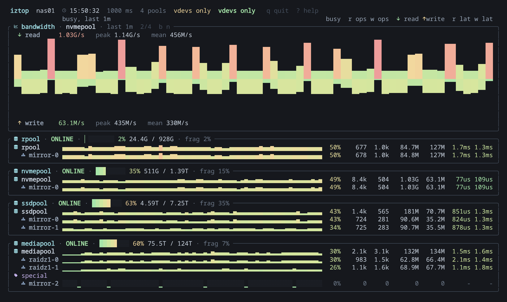

*After `l`: each pool shows only its vdevs, so more pools fit. Press `l` again to show the disks.*

### Graph

| Key | Action | Explanation |
|---|---|---|
| `g` | Graph mode | Cycles: *when there is room* (default) → *on* → *off*. The header confirms the mode. |
| `n`, `b` | Next or previous pool | Graphs the next or previous pool in display order; turns the graph on if it was off. |
| `a` | Busiest pool | Returns the graph to following the busiest pool. |
| `w` | History window | Cycles the span of every graph: the last *1 minute* (default) → *10 minutes* → *60 minutes*. |

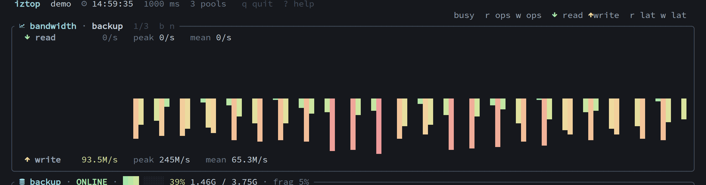

*After `n`: the graph's title names the pool and its position among the pools.*

### Display

| Key | Action | Explanation |
|---|---|---|
| `i` | Icons or ASCII | Nerd Font glyphs or plain ASCII markers. |

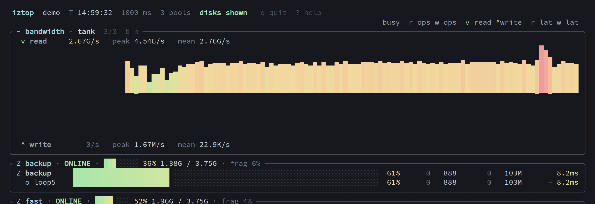

*After `i`: icons are replaced by ASCII characters.*

<a id="pools-menu"></a>
### Pools menu

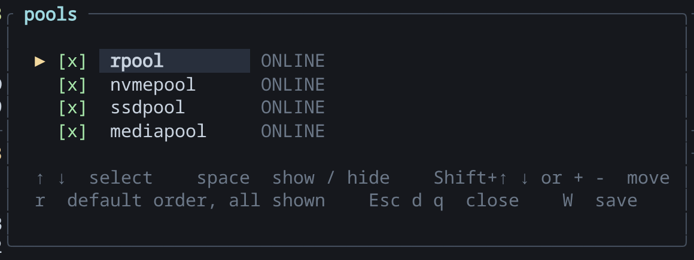

| Key | Action |
|---|---|
| `↑` `↓`, `j` `k`, `Home` `End` | Select a pool. |
| `Space`, `Enter` | Show or hide the selected pool (`[x]` shown, `[ ]` hidden). |
| `Shift+↑` `Shift+↓`, `+` `-`, `K` `J` | Move the selected pool up or down. |
| `r` | Default order (alphabetical), every pool shown. |
| `W` | Save the order and hidden pools to the configuration file. |
| `Esc`, `d`, `q` | Close the menu. |

---

## 8. Understanding the Interface


| No. | Area | What it shows |
|---|---|---|
| 1 | **Header** | Host name, clock, refresh interval, number of pools, and messages after a key press. |
| 2 | **Column legend** | The names of the figure columns on the right of every row. |
| 3 | **Bandwidth graph** | Read and write bandwidth for one pool over the history window. |
| 4 | **Pool title** | Pool name, health, scrub or resilver progress, capacity and fragmentation. |
| 5 | **Layout** | The pool, its vdevs and their disks, indented as in `zpool status`. |
| 6 | **Busy history** | How busy each disk has been over the history window. |
| 7 | **Figures** | Busy %, operations, bandwidth and latency. |

### Colours

Gauges and graph columns are coloured along a ramp from green through amber to red, so a column's
colour says how high it is. The dotted part of a graph is idle time; blank is time before iztop started. Latency is coloured on a
logarithmic scale: 100 µs and below is green, about 10 ms (an ordinary hard-disk access) amber, and
a second red. Anything unhealthy is red.

### Header (1) and legend (2)

The header shows `iztop`, the host name, the local time, the refresh interval and the number of
pools shown. After a key press it shows a short confirmation such as `graph: on` or
`refresh 2000 ms`.

### Bandwidth graph (3)

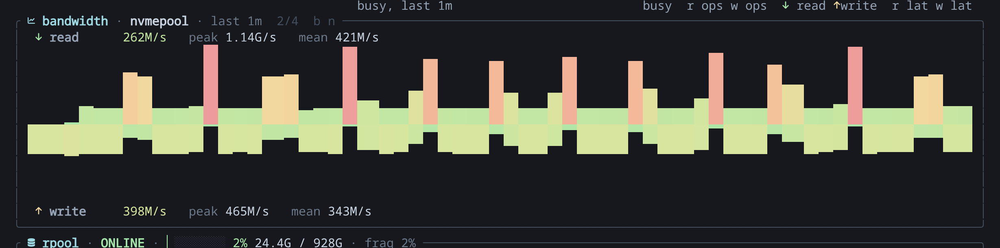

| Item | Meaning |
|---|---|
| Title | `bandwidth`, the pool graphed, the history window (`last 10m`), its position among the pools (`3/3`) and the keys `b` `n`. |
| `read` (top) | Read bandwidth now, the peak and the mean over the window; the read graph grows upwards. |
| `write` (bottom) | The same for writes; the write graph hangs downwards. |

Both halves share one scale, the highest rate in view, but never less than 1 MiB/s, so a pool at
rest is not drawn as busy. In the default mode the graph appears only when every pool fits on screen
with at least seven rows to spare, and is at most 14 rows high.

### Pool title (4)

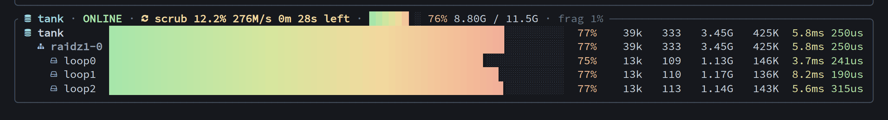

| Item | Meaning |
|---|---|
| Name | The pool's name. |
| Health | `ONLINE`, or in red `DEGRADED`, `FAULTED`, `SUSPENDED` and so on. |
| Scrub or resilver | While one runs: its percentage, current rate and estimated time left (or `paused`). After one has finished with errors: `scrub N errors` in red. |
| Capacity gauge and `%` | Allocated space as a share of the pool's size, rounded down as `zpool list` rounds it. |
| `8.80G / 11.5G` | Allocated and total size. Both are **raw**: parity included, as `zpool list` counts them, so a raidz pool's figures are larger than the usable space `zfs list` reports. |
| `frag` | Free-space fragmentation, as `zpool list` reports it. |

### Rows (5)

| Row | Example | Meaning |
|---|---|---|
| Pool | `tank` | The whole pool. |
| Vdev | `raidz1-0`, `mirror-0` | A redundancy group of disks. |
| Group | `special`, `logs`, `cache`, `spares`, `dedup` | A section of auxiliary devices; it has no figures of its own. |
| Disk | `loop0`, or a model and serial | One device. |

Disk names are shortened: the `ata-`, `nvme-`, `scsi-`, `usb-` or `sas-` prefix and any `-partN`
suffix are removed, and if the name is still too long, the start of the model is kept with the
whole serial number (`WDC_WD80…ABC123`). `p` shows full names.

When a vdev or disk is **not ONLINE**, or has read, write or checksum errors, the state and the
error counters (`READ/WRITE/CKSUM`, e.g. `0/0/3`) are written in red at the end of its name, and the
name gives way to them.


*One disk offline: the pool and its raidz vdev read DEGRADED and the disk OFFLINE, truncated to fit
the name column.*

### Busy history (6)

The graph shows, second by second, the share of time during which the disk had at least one I/O in flight, read from
the kernel's block-layer accounting for the **whole disk** (for a partition, its parent disk). A
mirror, raidz or pool row shows its **busiest** disk, because one saturated disk holds up the rest.
The newest second is at the right. iztop keeps an hour; `w` chooses whether the graph spans the
last 1, 10 or 60 minutes, and the legend above the graphs says which (`busy, last 1m`). When a
column covers more than one second it shows the **busiest** of them, so a short burst is not lost in a
long window. Busy near 100 % with low bandwidth usually means many small, slow operations.

### Figures (7)

| Column | Meaning | Unit |
|---|---|---|
| **busy** | Over the last interval: the graph's newest second. | % |
| **r ops**, **w ops** | Read and write operations per second. | operations/s (`k` = thousands) |
| **read**, **write** | Read and write bandwidth. | bytes/s (`K`, `M`, `G` binary) |
| **r lat**, **w lat** | Average **total wait** per operation: time queued in ZFS plus time at the disk. `-` when there were no operations. | `ns`, `us` (µs), `ms`, `s` |

All figures except busy are `zpool iostat`'s own, over the refresh interval. As the window narrows,
the **latency** columns are dropped first, then the **operations** columns.


### Measured and calculated values

| Kind | Values |
|---|---|
| **Measured by ZFS** (reported by `zpool iostat`, `status`, `list`) | Operations, bandwidth, latency, health, errors, size, allocation, fragmentation, scrub progress. |
| **Calculated by iztop** | Busy % (milliseconds with I/O in flight ÷ interval), the busiest-disk figure for vdev and pool rows, capacity %, scrub rate and time left, graph peak and mean. |
| **Display only** | Graph columns: the busiest second each covers. |

---

## 9. Advanced Usage

### Command-line options

| Option | Meaning | Default |
|---|---|---|
| `POOL…` | Show only these pools (shown even if hidden in the configuration). | every pool |
| `-i`, `--interval <MS>` | Refresh interval in milliseconds, 250–10000. | 1000 |
| `-l`, `--vdevs-only` | Hide the disks inside mirrors and raidz vdevs. | disks shown |
| `-g`, `--graph <MODE>` | Bandwidth graph: `auto` (when there is room), `on`, `off`. | `auto` |
| `-w`, `--window <SPAN>` | History the graphs span: `1m`, `10m` or `60m`. | `1m` |
| `--full-names` | Full device names, not shortened ones. | short |
| `--once` | Print one interval as plain text and exit. | |
| `--no-icons` | ASCII markers instead of Nerd Font glyphs. | icons |
| `--no-clock` | No clock in the header. | clock |
| `-c`, `--config <FILE>` | Configuration file. | `~/.config/iztop/iztop.conf` |
| `-V`, `--version` | Print the version and exit. | |
| `-h`, `--help` | Print the help text and exit. | |

### Configuration file

iztop's configuration file holds only what the pools menu sets, and is written only when you press
`W` in that menu. It lives at `$XDG_CONFIG_HOME/iztop/iztop.conf`, normally
`~/.config/iztop/iztop.conf` — for `sudo iztop`, root's home directory.

| Key | Meaning |
|---|---|
| `pool_order` | Pool names, comma-separated, shown first and in this order. Pools not listed follow alphabetically, so a newly imported pool still appears. |
| `pool_hidden` | Pool names, comma-separated, never shown unless named on the command line. |

Example:

```ini
# ~/.config/iztop/iztop.conf
pool_order = tank, fast
pool_hidden = backup
```

If a line is invalid, iztop reports it with its line number and applies the rest.

### Scripting with `--once`

`--once` reads one interval of `zpool iostat` and `zpool status`, prints a table and exits. Each
pool begins with a `#` line of pool-wide figures, followed by one row per vdev and disk. A real
sample from the demonstration pools:

```text
name                                        state      dev  busy%    r_ops    w_ops      r_bytes_s      w_bytes_s    r_wait_ns    w_wait_ns    errors
# pool fast health=ONLINE size=4026531840 alloc=2130553856 frag=4
fast                                       ONLINE        -   20.7        0     3478              0      400389454            -       202193     0/0/0
  mirror-0                                 ONLINE        -   20.7        0     3478              0      400397371            -       202193     0/0/0
    loop3                                  ONLINE    loop3   20.3        0     1739              0      200198890            -       198030     0/0/0
    loop4                                  ONLINE    loop4   20.7        0     1738              0      200200086            -       206359     0/0/0
# pool tank health=ONLINE size=12348030976 alloc=9443802112 frag=1
tank                                       ONLINE        -   43.8    44447        0     2912916655              0       103763            -     0/0/0
  raidz1-0                                 ONLINE        -   43.8    44449        0     2913022801              0       103759            -     0/0/0
    loop0                                  ONLINE    loop0   41.0    13672        0      896020314              0       101076            -     0/0/0
```

| Field | Meaning |
|---|---|
| `# pool` line | Name, health, raw size and allocation in bytes, fragmentation %, and `scrub=N%` or `resilver=N%` while one runs. |
| `name` | Indented by depth, as in `zpool status`. |
| `state` | The row's state. |
| `dev` | The kernel block device whose busy figure is used, or `-`. |
| `busy%` | Busy over the interval, as the **busy** column. |
| `r_ops`, `w_ops` | Operations per second. |
| `r_bytes_s`, `w_bytes_s` | Bytes per second. |
| `r_wait_ns`, `w_wait_ns` | Total wait per operation, in nanoseconds; `-` with no operations. |
| `errors` | `READ/WRITE/CKSUM` error counters. |

Examples:

```sh
# The busiest disk of every pool
sudo iztop --once | awk '$1!~/^#/ && $3!="-" && NR>1 {print $1, $4}' | sort -k2 -rn | head

# Any row that is not ONLINE, or has errors
sudo iztop --once | awk 'NR>1 && $1!~/^#/ && ($2!="ONLINE" || $NF!="0/0/0")'
```

---

## 10. Technical Details

### Architecture

iztop is a single Rust binary of about 3,300 lines in nine modules, with
`#![forbid(unsafe_code)]`:

| Module | Responsibility |
|---|---|
| `main.rs` | Command-line parsing, `--once`, the event loop and keys. |
| `zpool.rs` | Everything read from the `zpool` command: two feeds, each on its own thread. |
| `json.rs` | A small JSON reader for `zpool status -j` (no serialisation framework). |
| `disks.rs` | Busy figures from `/proc/diskstats`. |
| `app.rs` | Joins the iostat stream, the status feed and the busy figures; keeps an hour of history per row and per pool. |
| `config.rs` | The pools-menu configuration file. |
| `clock.rs` | Local time from `/etc/localtime` (TZif), without a date library. |
| `ui.rs` | Rendering with ratatui; gauges and graphs are written cell by cell. |
| `theme.rs` | Colour ramp and glyphs, shared with igtop and istop. |

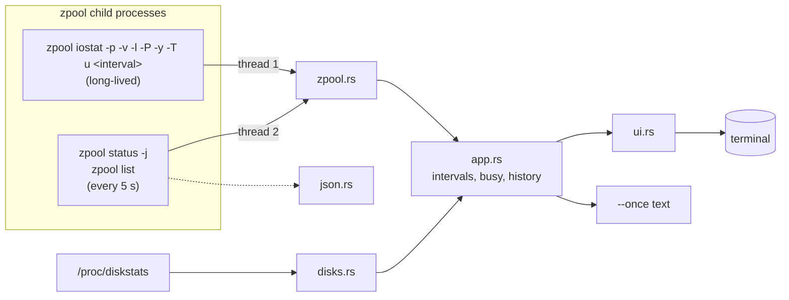

### Why the `zpool` command and not the kernel interface

Per-vdev statistics reach user space only as a packed nvlist through an `ioctl` on `/dev/zfs`, whose
layout is private to OpenZFS and changes between versions. The `zpool` command's output is its
stable, documented interface, so iztop reads that:

- **iostat feed.** One long-lived `zpool iostat -p -v -l -P -y -T u <interval>`: `-p` exact numbers,
  `-v` every vdev, `-l` latency, `-P` full device paths, `-y` skip the since-boot summary, `-T u` a
  Unix timestamp before each interval. ZFS flushes its output per pool rather than per interval, so
  iztop closes an interval on the next timestamp or after a 150 ms lull.
- **status feed.** `zpool status -j` (OpenZFS 2.3 or later) and `zpool list`, every 5 seconds:
  health, error counters, fragmentation, scrub and resilver. On older OpenZFS the JSON is skipped
  and health comes from `zpool list` alone.

Each feed runs on its own thread, so a slow or hung pool never stalls the screen.

### Busy figures

ZFS reports what it asked of a vdev, not how hard the device worked to do it. The kernel's block
layer counts, per device, the milliseconds during which it had I/O in flight (`/proc/diskstats`,
field 13); the change over an interval, divided by the interval, is its busy share. iztop maps each
leaf vdev's device path to its kernel name, and reads the whole disk when the vdev is a partition.

### History and drawing

Each row's busy figure and each pool's read and write bandwidth are stored as one value per second
of sampled time (the time-weighted mean of the intervals in it), an hour deep, whatever the refresh
interval. A graph `n` cells wide over a window of `w` seconds gives each cell `w ÷ n` seconds and
draws the highest second among them. The screen is redrawn only when a new interval arrives or a
key is pressed. Figures and `--once` are the interval's own.

### Permissions and safety

- iztop only reads. It runs `zpool iostat`, `zpool status` and `zpool list`, never a command that
  changes a pool.
- The `zpool` children get no input. If `zpool` cannot be run, iztop says so on screen, and
  `--once` exits with an error.

### Dependencies

| Crate | Version | Purpose |
|---|---|---|
| [ratatui](https://ratatui.rs/) | 0.29.0 | Terminal user interface. |
| [crossterm](https://github.com/crossterm-rs/crossterm) | 0.28.1 | Terminal input and output. |
| [rustix](https://github.com/bytecodealliance/rustix) | 0.38 | Process system calls without `unsafe` code in iztop. |

At run time iztop needs only the `zpool` command.

### Limitations

- Linux on x86-64 only; FreeBSD's ZFS is not supported (iztop reads `/proc/diskstats`).
- Health, errors and scrub detail need OpenZFS 2.3 or later.
- File vdevs have no busy figure.
- The name column is narrow in a small window, so long state words are truncated (`OFFLI` for
  `OFFLINE`).
- Health and scrub progress refresh every 5 seconds, whatever the refresh interval.

---

## 11. Development

### Building

| Task | Command |
|---|---|
| Debug build | `cargo build` |
| Optimised build for this machine | `cargo build --release` → `target/release/iztop` |
| Static, portable binary | `./build.sh` → `target/x86_64-unknown-linux-musl/release/iztop` |
| Tests | `cargo test` |
| Lints, as CI runs them | `cargo clippy --all-targets -- -D warnings` |

The minimum Rust version is **1.88**, set by the locked dependencies in `Cargo.lock`; the project
builds with 1.88.0 and with current stable.

<a id="static-builds"></a>
### Static builds

`build.sh` produces a musl-linked static binary for baseline x86-64, so it runs on any x86-64 Linux
and any x86-64 CPU. It needs the musl target, and `objdump` (from binutils) for its final check:

```sh
rustup target add x86_64-unknown-linux-musl
./build.sh
```

The script refuses the result if it contains AVX-512 instructions. Some distributions (CachyOS, for
one) ship a Rust standard library built for x86-64-v4, which puts AVX-512 instructions in every
binary regardless of `-C target-cpu`; such a binary dies with `Illegal instruction` on older CPUs.
If `build.sh` reports this, rebuild the standard library from source:

```sh
rustup component add rust-src
IZTOP_BUILD_STD=1 ./build.sh
```

### Testing with demonstration pools

You can try iztop without touching real pools by building small pools on loop devices, as the
screenshots were made. **This creates real pools; run it only on a test machine, and destroy them
afterwards.** The commands are for `bash`, which splits `$L` into separate device names.

```sh
mkdir -p ~/zdemo && for i in 0 1 2; do truncate -s 2G ~/zdemo/d$i.img; done
L=$(for i in 0 1 2; do sudo losetup --show -f ~/zdemo/d$i.img; done)
sudo zpool create -o cachefile=none demo raidz1 $L     # cachefile=none: not re-imported at boot
sudo iztop demo
sudo zpool destroy demo && for d in $L; do sudo losetup -d $d; done && rm -r ~/zdemo
```

### Packaging

| Path | Purpose |
|---|---|
| `Cargo.toml` → `[package.metadata.deb]` | Debian package, built with `cargo deb`. |
| `Cargo.toml` → `[package.metadata.generate-rpm]` | RPM package, built with `cargo generate-rpm`. |
| `packaging/aur/PKGBUILD`, `.SRCINFO` | Arch Linux package. |
| `.github/workflows/ci.yml` | On every push: clippy, tests and `build.sh`. |
| `.github/workflows/release.yml` | On a published release: builds the static binary, `.deb`, `.rpm` and `SHA256SUMS`, tests them in eight distribution containers, then uploads them. |

### Contributing and reporting problems

Bug reports and pull requests are welcome through
[GitHub issues](https://github.com/GladTechInfo/iztop/issues). Please include `iztop --version`,
`zpool version`, the distribution and kernel (`uname -r`), and, where a figure looks wrong, the
output of `sudo iztop --once`. Before sending a pull request, run
`cargo clippy --all-targets -- -D warnings` and `cargo test`.

---

## 12. Licence

iztop is free software, licensed under the **GNU General Public License v3.0 or later**
(`GPL-3.0-or-later`). See [LICENSE](LICENSE) for the full text.

It is built with [ratatui](https://ratatui.rs/) and
[crossterm](https://github.com/crossterm-rs/crossterm) (both MIT-licensed) and
[rustix](https://github.com/bytecodealliance/rustix) (Apache-2.0 WITH LLVM-exception, Apache-2.0
or MIT). It reads the output of OpenZFS's `zpool` command; OpenZFS is a separate project under the
CDDL. Its interface follows [igtop](https://github.com/GladTechInfo/igtop) and
[istop](https://github.com/GladTechInfo/istop).
